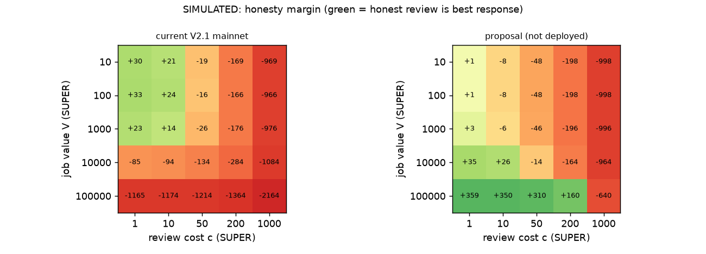
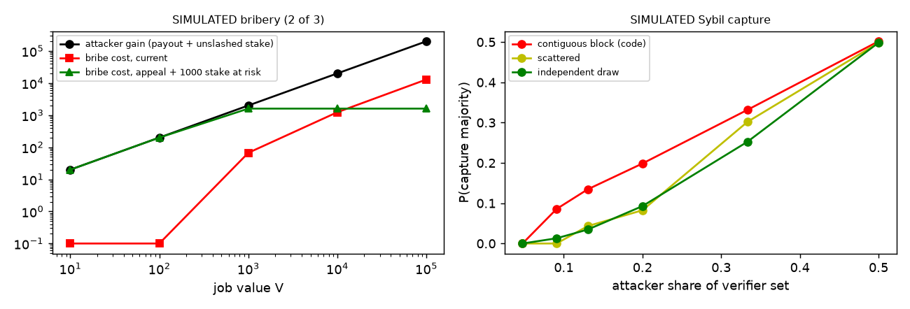

# Superion dispute mechanism: incentive analysis

*Prepared for the Ethereum Foundation ESP (Nov 2026). Status: draft for review. Updated 2 Nov 2026 with the V3 section (§7).*

**Scope and honesty statement.** This note covers the JobMarketplace V2.1 contract deployed on Base mainnet at `0x5F0297A5B5F5444920e6673f1b60D5d1f1b302C1`. Source: `contracts/v2/SuperionJobMarketplaceV2.sol` and `SuperionStakingV2.sol`. Parameters were read from `params()` on-chain on 2 Nov 2026. The contract has **0 jobs and 0 registered verifiers**, so there is no usage data. Every number labelled *simulated* comes from a simple model (`mechanism/sim/dispute_sim.py`, deterministic) and is not an observation. Chainlink VRF is used only on the Base Sepolia testnet. Mainnet uses the commit-reveal selection described below. Anything marked **Proposal** is not in the code.

## 0. Mechanism as implemented (mainnet values)

| Item | Value / rule | Code |
|---|---|---|
| Currency | SUPER token; budget escrowed at creation | `createJob` |
| Worker (provider) stake | `providerStakeBps`=10000 → 100% of budget locked from staking | `assignJob` |
| Optimistic window | `challengePeriod`=3600 s; then anyone may `finalizeJob` | `submitResult`, `finalizeJob` |
| Challenge | anyone except the provider (the client included); flat `challengeBond`=25 SUPER | `challengeJob` |
| Committee draw | challenger commits seed. After ≥60 s and ≤180 s reveals it. `start = keccak(seed, blockhash(commitBlock+1), jobId) mod n`, then the next `committeeSize`=3 **consecutive** entries of `verifierList` are taken. Creator, provider and challenger are skipped by address | `revealCommittee` |
| Seed not revealed | bond burned, job returns to Completed and can be finalized | `expireUnrevealedChallenge` |
| Verifier eligibility | `registerVerifier` locks `minVerifierStake`=1000 SUPER. Cap 200 verifiers. No identity or reputation check. Unstake has a 7-day unbonding period | `registerVerifier`, `SuperionStakingV2.requestUnstake` |
| Voting | commit (150 s) then reveal (150 s), `keccak(vote,salt,addr,jobId)` | `commitVote`, `revealVote` |
| Decision | strict majority of committee size (2 of 3) | `majorityOf`, `resolveDispute` |
| Work valid | provider paid. Challenger bond split among majority voters (to provider if no winners) | `_settle` |
| Work invalid | client refunded. Challenger bond returned. Provider stake slashed: 10% to challenger, 20% to majority voters, 70% burned | `_settle` |
| Verifier penalty | flat `verifierPenalty`=100 SUPER for **minority, absent or unrevealed** voters, burned. Below 1000 bond the verifier is removed from the list | `_settle`, `_penalize` |
| No majority | arbiter (= Timelock) may decide within `arbitrationWindow`=3600 s. Otherwise `resolveStale`: client refunded, bond returned, provider stake unlocked (not slashed), non-revealing verifiers penalized | `arbitrate`, `resolveStale` |
| Fees | `feeBps`=0. If raised (max 10%), the split is `burnShareBps`=50% burned, rest to stakers. No treasury share in V2.1 | `_payProvider`, `setFees` |

Note: the testnet-length windows (60–180 s seed, 150 s vote phases, 1 h arbitration) are live on mainnet. The config file proposed longer mainnet values that were never applied (`scripts/v2/config.cjs`, `MARKETPLACE_PARAMS_MAINNET_PROPOSAL`).

## 1. Who funds verifier rewards, and why would independent people review?

**Code today.** Verifiers are paid only when a dispute happens, and only from the losing side. If the work is upheld, they share the challenger's 25 SUPER bond. If it is rejected, they share 20% of the provider's slashed stake. Nothing comes from protocol fees or a treasury, and nobody pays for reviews when there is no dispute. The pay does not depend on the review cost, and it differs a lot between outcomes: 25 SUPER versus 0.2×V. *Simulated*: when V ≥ ~10,000 SUPER, always voting "invalid" without reviewing pays more than reviewing honestly (`results.md`, current-rules table). The vote windows are 150 s, too short for a real review.
**Proposal.** (a) Pay a flat per-vote fee to each revealed voter, the same whatever the outcome, funded by the losing side's bond. (b) Fund a minimum fee from the planned treasury share of protocol fees, so small jobs can still pay for a review. (c) Set vote windows in days.

## 2. Economic benefit per role

- **Client:** escrow, a worker stake of 100% of the budget, and a refund if the work is rejected. Cost: 25 SUPER at risk per challenge. **Risk today (gap):** with 0 verifiers, a challenge draws an empty committee, so no majority is possible. The Timelock arbiter needs about 8 days of governance (1 d delay + 5 d vote + 2 d timelock) but has a 1 h window. The dispute therefore always ends in `resolveStale`: the client is refunded and gets the bond back. Any client can claw back any finished job at no cost, which is a griefing vector against workers.
- **Worker:** payment within ~1 h if no challenge, with no fee today. Cost: capital equal to 100% of the budget locked during the job.
- **Verifier:** paid only from disputes (see §1). Takes a 100 SUPER penalty risk per seat and locks 1000 SUPER.
- **Challenger (third party):** gets 10% of the provider's slashed stake plus the bond back if right, and loses 25 SUPER if wrong.
- **Stakers:** nothing until `feeBps` > 0. Then they get a share of fees after the burn.
We make no claim about the size of any of these benefits. They depend on fee level, token price and dispute rate, and none of these is known.

## 3. Bond calibration vs review cost, job value and attacks

**Code today.** The challenge bond (25) and verifier penalty (100) are flat. They do not scale with job value or review cost. The provider stake scales with value (100%). *Simulated* (k=3, accuracy 0.9): honest review is the best response only in a narrow band, roughly V ≤ 1,000 and review cost c ≤ ~10 SUPER-equivalent. Above that, flat amounts are too small to matter, and the 20%-of-slash bonus pulls voters toward "invalid".
**Proposal (simulated, not deployed).** Bond = max(25, 10%·V). Non-reveal penalty = max(100, 5%·V). Symmetric per-vote fee f = max(10, 3%·V). In the model, honesty dominates only when f is above roughly 3× the review cost. A protocol minimum fee is therefore needed for small jobs, or small jobs should be routed to a cheaper path (e.g. client-only acceptance).

## 4. Dishonesty vs reasonable disagreement on subjective work

**Code today.** The contract has no notion of this. Every minority voter loses the same 100 SUPER, whether careless or reasonably in disagreement. *Simulated*: an honest reviewer with accuracy 0.8 ends up in the minority about 16% of the time, an expected loss of ~16 SUPER per dispute. This pushes reviewers to guess the majority instead of judging the work. There is no rubric, appeal or evidence field. Job specs are an off-chain `jobURI`.
**Proposal.** Do not slash revealed minority votes (they just earn nothing). Slash only for non-reveal, and for being in a majority that an appeal overturns. Require a structured acceptance rubric in `jobURI` at creation, so that most disputes become checkable criteria rather than taste. Keep purely subjective work out of scope during pilots.

## 5. Sybil, collusion, wrong majority

**Code today.** The only Sybil cost is 1000 SUPER of locked (not spent) stake per address. Exclusion works by address only. Three weaknesses come from the code:
(i) **Contiguous committee.** Seats are consecutive list entries, so an attacker who registers back-to-back addresses gets correlated seats. *Simulated*, with 20 honest verifiers: 2 attacker IDs (9% share) capture 2 of 3 seats 8.6% of the time with contiguous selection, versus 1.3% with independent draws.
(ii) **Re-roll.** The challenger knows the committee as soon as `commitBlock+1` is mined, before revealing. If the draw is unfavourable, the challenger can let it expire (25 SUPER burned) and, because `expireUnrevealedChallenge` sets `challengeDeadline = now`, apparently re-challenge in the same block. This still needs a test to confirm. *Simulated*: 3 re-rolls raise capture from 8.6% to 30%.
(iii) **Bribery.** Votes are revealed publicly, so a bribe can be verified and enforced. A provider with bad work gains 2V (payout plus unslashed stake). *Simulated*: buying 2 of 3 votes costs far less than that at every job size tested.
**Proposal.** Independent sampling without replacement, weighted by stake. Remove the challenger's option to see the committee before revealing (e.g. randomness the challenger cannot see in advance, or a reveal by the protocol). Block re-challenge after expiry. Add an appeal to a larger committee where an overturned majority is slashed. For bribery to be unprofitable, the slashable stake per majority voter must be at least about V / P(overturn), so cap job value relative to verifier stake (*simulated*: about 1,250 SUPER at risk per verifier for a 1,000 SUPER job).

## 6. Bootstrapping with no volume or reputation

**Code today.** Nothing specific. With fewer than 3 eligible verifiers the committee is smaller (k=1 makes one verifier decisive). With 0 verifiers the free-refund path from §2 applies. That is the current mainnet state.
**Proposal.** Pilots with a known, small verifier set (bonded, publicly listed, conflicts disclosed) and a job-value cap. Raise the windows to days before opening disputes. Clients come from B2B integrations (SDK/API) on objectively checkable tasks (code with tests, data labelling with gold items). Publish every dispute outcome so that real data can replace the simulated parameters. Fees stay at 0 during pilots.

## Known gaps in V2.1 requiring a contract change (fixed in V3, §7)

1. Committee selection: contiguous window → independent stake-weighted sampling.
2. Challenger sees the committee before revealing, and can apparently re-roll via expire plus same-block re-challenge.
3. Empty or undersized committee leads to `resolveStale` with a free client refund. Need: no dispute without k eligible verifiers, and the bond goes to the provider in that case.
4. Arbiter (Timelock, ~8-day governance path) cannot act inside the arbitration window, so it should be a dedicated arbiter role or have a longer window.
5. Verifier pay: symmetric per-vote fee, plus a minimum funded by the treasury share. A treasury share of fees does not exist yet (decided hybrid model, percentage set after pilots).
6. Bond and penalty scaling with job value. Today the minimum bond is a constant and the amounts are flat in `Params`.
7. No slashing of revealed minority votes. Add an appeal round with slashing of overturned majorities.
8. Job-value cap tied to verifier stake.
Parameter-only fix (no code change, governance `setParams`): realistic windows (days) and the mainnet values from `MARKETPLACE_PARAMS_MAINNET_PROPOSAL`.

## Next steps
Items 1–8 are now implemented and tested on testnet (V3, see §7). Next: external audit of V3, testnet pilot with mainnet parameters and value caps, then mainnet deploy via Safe/Timelock. Dispute data will be published and labelled as observed.

## 7. V3: what changed (2 Nov 2026, Base Sepolia testnet only)

The ESP reviewer questions led to this review; the 8 gaps above are addressed in `SuperionJobMarketplaceV3` (see `contracts/v3/CHANGELOG_V3.md`). **V3 is deployed and verified only on Base Sepolia** (marketplace `0x220Df97AA2faA3255BbF4F3D043b92B2B269E7CA`, staking `0xD60AD2FD5AD8DA6ED1Dbe262e025f26487C82713`). **It is not audited and not on mainnet.** Mainnet still runs V2.1 as described in §0; we do not direct users to it until V3 is audited and deployed.

| Gap (V2.1) | V3 rule |
|---|---|
| 1. Contiguous committee | `k` independent stake-weighted draws without replacement; creator, provider and challenger excluded |
| 2. Challenger-chosen seed, re-roll | randomness = hash of the block after the challenge (`drawCommittee`); no seed, no expire/re-roll path, one challenge per job |
| 3. Free refund with no verifiers | dispute needs ≥ 3 eligible verifiers; no job creation with zero verifiers; no free-refund path |
| 4. Arbiter cannot act in time | dedicated arbiter role (granted by governance), 14-day window on mainnet; no majority and no decision → 50/50 split |
| 5. Verifier pay | equal per-vote fee for every revealing verifier; treasury share of fees set by governance only, hard cap 50 % of the fee, default 0 |
| 6. Flat amounts | bond, penalty and vote fee are % of job value, with floor and cap |
| 7. Minority slashed | revealed minority votes are not slashed, only non-reveal; one appeal round to a larger committee, original majority slashed if overturned |
| 8. Bribery | job value capped at 50 % of total verifier stake |

Proposed mainnet windows (days, not seconds): challenge 3 d, vote commit 3 d, reveal 2 d, appeal 3 d, arbitration 14 d; committee 5, appeal committee 9. **Tests:** 53 passing, 21 of them new for V3, including attack tests (re-roll, empty committee, consecutive-registration Sybil, bribery cap) and a V2.1 re-draw reproduction.

**New simulation results (simulated, not real data; `sim/dispute_sim_v3.py`, `sim/out/results_v3.md`).**
- With the tuned amounts in the mainnet proposal (bond 20 %, penalty 50 % with floor and cap), honest review is the best strategy for every tested job value when the review cost is modest (c ≤ 50 SUPER at accuracy 0.9).
- With the short testnet amounts, it is not dominant; and without the appeal round it is never dominant, so the appeal is what rewards accuracy.
- Known limits remain: small jobs with long reviews are not covered by the fee (hence the pilot scope below); bribery is reduced, not eliminated; next-block blockhash randomness can be influenced by the Base sequencer; the draw must be triggered within ~256 blocks after the challenge.

**Plan.** External audit of V3 (not V2), then a testnet pilot with the mainnet parameters, then a mainnet deploy through the Safe/Timelock. The treasury share stays 0 until the pilots end.

## Pilot scope

*Decision of 2 November 2026.* For pilots, Superion accepts **only jobs that are quick and objective to verify**:

- **Eligible jobs:** code delivered with automated tests the verifiers can run; data annotation / labelling with a clear acceptance checklist; other tasks with a short, objective acceptance grid.
- **Required acceptance checklist:** written into the job spec **before work starts** (the checklist template is an internal document, not part of this repository).
- **Target review time:** a design goal — a job should be reviewable in under ~30 minutes. This is a target, not a measured figure.
- **Excluded for now:** subjective or creative work (design, copywriting, marketing…), long reports.

*Why:* the mechanism simulations (`mechanism/sim`, v3 results) indicate that on small jobs the per-vote fee does not cover a long subjective review, so honest review is not rational there. The V3 contract exists on Base Sepolia only (not audited, not on mainnet).
